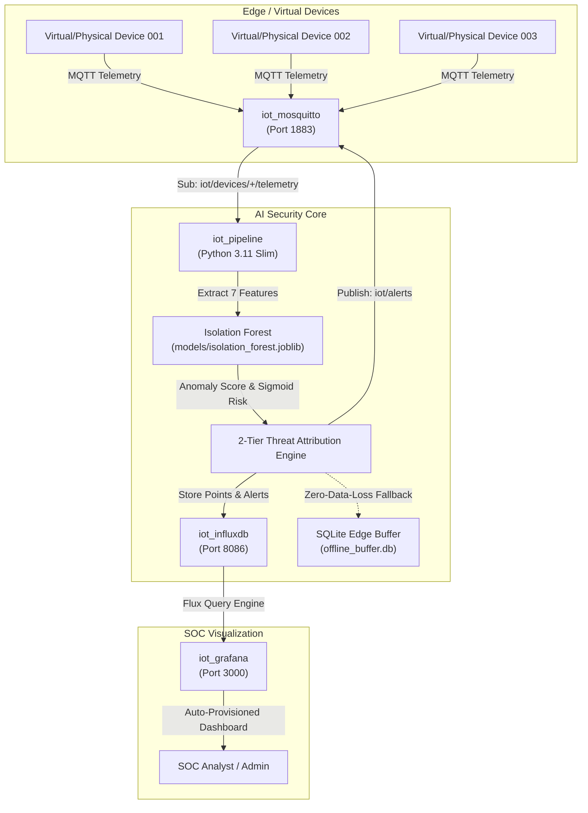

# Production Deployment Guide
## AI-Based IoT Cyberattack & Device Anomaly Detection (Project P_310)

This guide documents the enterprise containerization and deployment process for the IoT AI Cyberattack and Anomaly Detection system.

---

## 1. System Architecture

The entire pipeline is containerized into a microservices architecture managed through Docker Compose:



---

## 2. Containerized Services & Ports

| Container Name | Service | Base Image | Ports | Volumes |
| :--- | :--- | :--- | :--- | :--- |
| **`iot_mosquitto`** | Native MQTT 3.1.1 / 5 Broker | `eclipse-mosquitto:2` | `1883:1883` | `mosquitto_data`, `mosquitto_log` |
| **`iot_influxdb`** | Time-Series Metric & Alert DB | `influxdb:2.7` | `8086:8086` | `influxdb_data:/var/lib/influxdb2` |
| **`iot_grafana`** | SOC Dashboard & Analytics | `grafana/grafana:10.4.0` | `3000:3000` | `grafana_data:/var/lib/grafana` |
| **`iot_pipeline`** | AI Detector & Telemetry Engine | Custom `python:3.11-slim` | Internal | `collector_cache:/app/data/cache` |

---

## 3. Quickstart Deployment

### Prerequisites
- [Docker Engine & Docker Compose](https://docs.docker.com/get-docker/) (v2.20+)
- 2 GB available RAM
- 5 GB free disk space

### A. Windows (One-Click)
Double-click `deploy.bat` or run:
```powershell
.\deploy.bat
```

### B. Linux / macOS / Cloud VPS
Make the script executable and run:
```bash
chmod +x deploy.sh
./deploy.sh
```

### C. Standard Docker Compose Command
From the project root:
```bash
docker compose up -d --build
```

---

## 4. Verification & Health Check

After launching, check container statuses:
```bash
docker compose ps
```

Expected output:
```text
NAME            IMAGE                    STATUS          PORTS
iot_grafana     grafana/grafana:10.4.0   Up (healthy)    0.0.0.0:3000->3000/tcp
iot_influxdb    influxdb:2.7             Up (healthy)    0.0.0.0:8086->8086/tcp
iot_mosquitto   eclipse-mosquitto:2      Up              0.0.0.0:1883->1883/tcp
iot_pipeline    iot-security-pipeline    Up (healthy)    
```

### Accessing the Web Consoles

1. **Grafana SOC Dashboard:**
   - **URL:** [http://localhost:3000/d/iot-security-overview](http://localhost:3000/d/iot-security-overview)
   - **Username:** `admin`
   - **Password:** `admin`
   *(Auto-refreshes every 5 seconds with live gauges, telemetry charts, and the incident response log)*

2. **InfluxDB Time-Series Explorer:**
   - **URL:** [http://localhost:8086](http://localhost:8086)
   - **Username:** `admin`
   - **Password:** `adminpassword123`
   - **Organization:** `iot_security_org`
   - **Bucket:** `iot_telemetry`

---

## 5. Live Stream & Threat Simulation

The container `iot_pipeline` continuously runs `run_live_stream.py`:
- Emits Gaussian telemetry across 3 virtual devices (`device_001`, `device_002`, `device_003`) every 2 seconds.
- Calculates continuous ML risk scores and checks for statistical outliers.
- Periodically (every ~2 minutes) injects dynamic threat bursts:
  - **DoS Flooding Attack:** High packet rate + CPU spike on `device_001`
  - **Brute-Force Authentication:** Rapid `failed_auth_count` spikes on `device_002`
  - **Hardware Sensor Tampering / Surge:** Extreme overvoltage (>270V) on `device_003`

To observe live detection logs directly in your console:
```bash
docker logs -f iot_pipeline
```

---

## 6. Connecting Physical IoT Hardware

To ingest telemetry from physical microcontrollers (e.g., ESP32, ESP8266, Raspberry Pi, Arduino):

1. Configure the device's WiFi and MQTT client to target your server's IP address on port `1883`.
2. Publish JSON payloads to the topic pattern:
   ```text
   iot/devices/<YOUR_DEVICE_ID>/telemetry
   ```
3. Use the standardized schema:
   ```json
   {
     "device_id": "esp32_sensor_01",
     "timestamp": "2026-10-31T14:00:00.000Z",
     "temperature": 24.8,
     "voltage": 230.2,
     "cpu_usage": 14.5,
     "ram_usage": 38.2,
     "message_rate": 1.0,
     "failed_auth_count": 0,
     "network_latency": 12.4
   }
   ```
The AI pipeline will validate the schema, extract the 7-metric vector, infer anomaly risk, store the observation in InfluxDB, and alert on any threat pattern.

---

## 7. Cloud VPS Deployment (AWS EC2 / DigitalOcean / Azure)

When deploying to a public cloud VM:
1. Clone the repository onto the server:
   ```bash
   git clone https://github.com/opcrysta/CSE-082-AI-Based-IoT-cyberattack-and-device-anomaly-detection-.git
   cd CSE-082-AI-Based-IoT-cyberattack-and-device-anomaly-detection-
   ```
2. Configure Security Group / Firewall rules:
   - Allow Port `3000` (Grafana) - or reverse-proxy with Nginx on Port `80`/`443`.
   - Allow Port `1883` (MQTT) only from trusted device subnets or via TLS.
   - Keep Port `8086` (InfluxDB) bound locally (`127.0.0.1:8086`) for internal access only.
3. Launch with:
   ```bash
   ./deploy.sh
   ```

---

## 8. Maintenance Commands

- **Stop all services:**
  ```bash
  docker compose down
  ```
- **Stop and wipe all stored data (clean slate):**
  ```bash
  docker compose down -v
  ```
- **Restart all services:**
  ```bash
  docker compose restart
  ```
- **Rebuild after making code modifications:**
  ```bash
  docker compose up -d --build iot_pipeline
  ```
